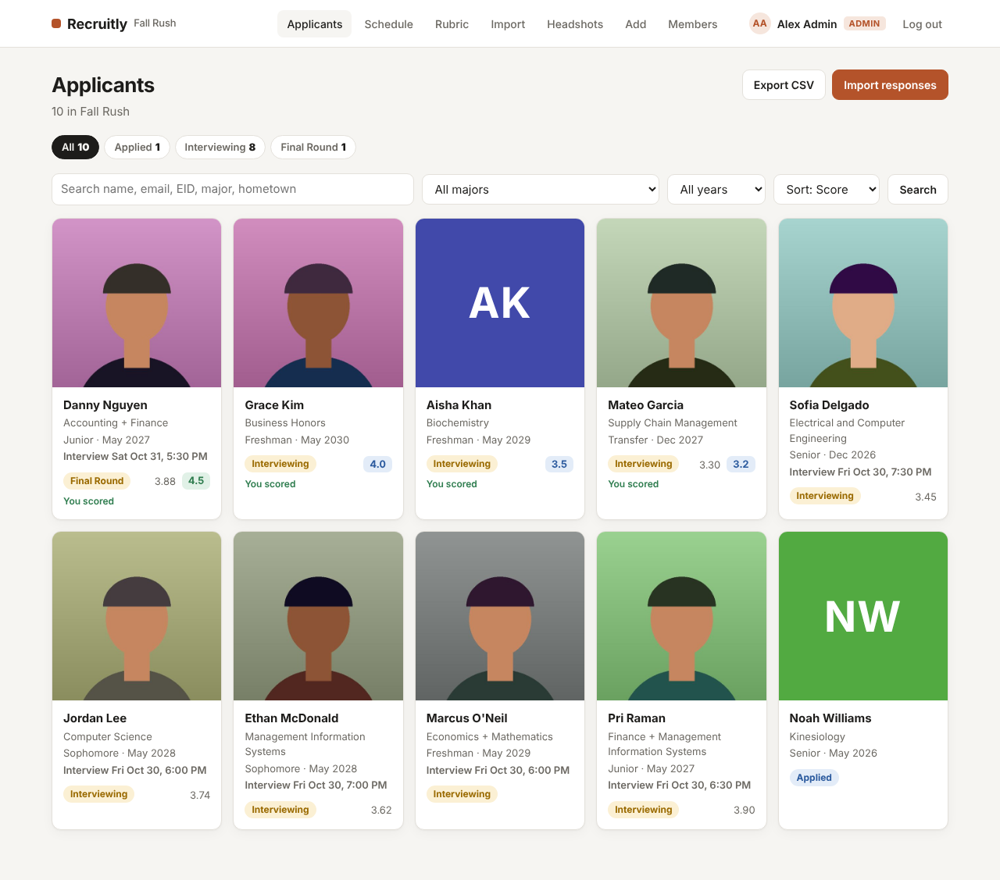

# Recruitly

Applicant tracking for student org recruitment. Point it at your Google Form responses, and it builds a clean profile for every applicant, with their headshot, major, year, GPA, links and short answers, in one place your whole exec team can use.



## Why

Most orgs run recruitment out of a Google Form and a messy spreadsheet. Names come in as `jOHN`, majors as `cs`, `comp sci` and `Computer Science`, phone numbers in five formats, and someone always submits twice. Headshots end up in a Drive folder that nobody can match to the right row. Recruitly fixes all of that on import and gives you a board you can actually run rush from.

## Features (v0.4)

- **Scoring rubric and notes.** Admins set up the rubric on the **Rubric** page: criteria like Communication or Fit, each scored 1 to 5, with a weight (a 2 counts twice as much as a 1) and an optional "what to look for" line. Rounds (First round, Final round, or your own) get separate score sheets.
  - Everyone on the team fills in a **score sheet** per applicant per round: a 1-5 score for each criterion plus written notes. Save a draft and finish it later, or submit it. Submitted sheets can still be edited.
  - **No anchoring:** you can't see anyone else's scores or notes for an applicant in a round until you've submitted your own. Drafts are only ever visible to the person writing them. Admins can look before scoring (they run deliberations), but other people's scores stay folded away until they choose to open them.
  - Profiles show each member's scores and notes, the weighted score of every sheet, per-criterion averages for the round, and the applicant's overall average.
  - The board shows each applicant's average and can **sort by score**. Members only see averages for applicants they've scored, so the board can't anchor them either.
  - The score sheet opens on the round that matches the applicant's latest interview slot label.
  - Removing a member keeps their sheets (shown as "Former member"); editing the rubric re-weights every average.

- **Interview scheduling.** Admins add interview slots (date, time, length, room or Zoom link, interviewers), several back-to-back slots at once.
  - Book applicants from the **Schedule** page or from their profile. An applicant can't be in two overlapping slots, a slot holds one applicant, and interviewers can't be double booked.
  - Booking someone who's still *Applied* moves them to **Interviewing** automatically.
  - The schedule is grouped by day, with filters for *I'm interviewing* and *Open*. The board and profiles show each applicant's next interview.
  - **Export to your calendar** as an `.ics` file, either every slot or just the ones you're interviewing in. It works with Google Calendar, Apple Calendar and Outlook.
  - Members see the full schedule read-only. Only admins create, book or change slots.

- **Accounts and roles.** Everyone logs in with their own email and password. **Admins** can do everything and manage the team; **members** can view the board and every profile, but can't change anything.
  - The first account, created on a one-time setup page, becomes the admin.
  - Admins invite people with **one-time signup links** (optionally locked to one email, expire after 7 days), change roles, and remove access, all from the **Members** page. Recruitly never sends email, so you paste the link into GroupMe or Slack.
  - Passwords are hashed with Argon2, sessions are signed cookies, every form has a CSRF token, and repeated wrong passwords lock the login for a few minutes.
  - Headshots are only served to logged-in members.
- **Google Form import** from a CSV export or a shared Google Sheets link
- **Automatic column mapping.** Form questions like "What is your major?" or "Expected graduation date" are matched to profile fields, and you can fix any mapping before importing.
- **Validation and cleanup**, with every change listed so you can check it:
  - names capitalized properly (`mcdonald` → `McDonald`, `O'NEIL` → `O'Neil`), and "Full name" split into first and last
  - emails lowercased, with common typos fixed (`@utexas.com` → `@utexas.edu`, `@gmial.com` → `@gmail.com`)
  - majors matched to the official list (`comp sci` → Computer Science, `MIS` → Management Information Systems, `Kinesology` → Kinesiology), and double majors split
  - phone numbers, graduation terms (`spring 2028`, `5/2027`, `'29`), GPAs (`3.9/4.0`, `4.3/5`), class standing, LinkedIn and Instagram all put into one format
  - bad data flagged instead of silently saved (an invalid email skips the row, and an out-of-range GPA is left blank with a warning)
- **Preview before saving.** See exactly what will be created, updated or skipped.
- **Duplicate handling.** If someone submits twice, only their newest response is kept. Re-importing updates existing profiles instead of duplicating them.
- **Headshots**, downloaded from Drive links when shared, or matched in bulk from the Drive folder zip (Google names uploads `IMG_1234 - Jordan Lee.jpg`, so Recruitly matches by name, email or EID). Images are rotated correctly, cropped to a square and resized.
- **Applicant board** with search, filters by status, major and year, sorting, and status tracking (Applied → Interviewing → Final Round → Offered → Accepted)
- Manual add and edit, using the same cleanup rules as imports
- CSV export
- Works on phones

## Quick start

You need Python 3.10 or newer.

```bash
git clone https://github.com/aabanehsan/recruitly
cd recruitly
python3 run.py demo
```

That one command sets up everything the first time, loads 12 sample form responses (fictional people, deliberately messy data), creates two demo logins, adds interview slots (yesterday's first round plus two days starting tomorrow), a four-criterion rubric with score sheets from yesterday's interviews, and opens the app at http://localhost:8000:

| Role | Email | Password |
|---|---|---|
| Admin | `admin@demo.recruitly.dev` | `demo-admin-2026` |
| Member | `member@demo.recruitly.dev` | `demo-member-2026` |

They're printed in the terminal and shown on the login page too. Log in as the member to see the read-only view and the anchoring rule: Morgan can see everyone's scores for Danny and Grace (Morgan scored them) but not for Mateo, and Aisha still has an unfinished draft.

Use `python3 run.py` without `demo` to start fresh: the first page asks you to create the admin account, then you invite the rest of your exec team from **Members**.

Prefer to manage the environment yourself?

```bash
pip install -e .
recruitly demo          # or just: recruitly
```

## Importing your form

1. Open your Google Form's **Responses** tab and click **View in Sheets**.
2. Either download the sheet as **.csv** and upload it on the Import page, or share it as "Anyone with the link" and paste the link.
3. Review the preview, fix any column mappings, and click **Import**.
4. For headshots: if Drive blocked the downloads (it usually does for private form uploads), download the form's upload folder from Drive as a zip and drop it on the **Headshots** page.

You can also import from the terminal:

```bash
recruitly import responses.csv
```

## Accounts

- **First run:** open the app and create the admin account. That page disappears once an account exists.
- **Inviting:** Members → *Create invite link*, then send the link. Each link works once. If you fill in an email, only that address can sign up with it.
- **Roles:** admins can import, edit, change statuses, upload headshots, schedule interviews, export and manage members. Members can view applicants and the interview schedule, download calendar files, and fill in their own score sheets. There's always at least one admin, and you can't demote or remove yourself.
- **Forgot a password?** Anyone can change their own on the account page. If someone is locked out, run `recruitly reset-password their@email.edu` on the machine running Recruitly. Changing a password signs that person out everywhere else.

## Interviews

1. On **Schedule**, fill in *Add interview slots*: pick the date, start time, length and how many back-to-back slots you want, a room or a Zoom/Meet link, and who's interviewing.
2. Book applicants with the dropdown on each open slot, or from an applicant's profile (*Book an open slot*).
3. Interviewers click **My interviews (.ics)** and open the file to add their slots to their calendar. If the schedule changes, download it again to pick up the new times.

Times are in the org's time zone (`RECRUITLY_TIMEZONE`, Central time by default). Past slots are hidden unless you click *Show past*.

## Scoring

1. An admin opens **Rubric**, adds the criteria and weights, and renames or adds rounds to match how you interview. Naming rounds like your slot labels (e.g. "First round") lets the score page pick the right round automatically.
2. After an interview, open the applicant and click **Score** next to the round. Pick 1-5 for each criterion, write notes, and **Submit scores** (or **Save draft** to finish later).
3. Once you've submitted, everyone else's scores and notes for that round appear on the profile. Sort the board by **Score** to see who's on top.

Changing a weight re-calculates every average. Removing a criterion deletes its scores, and a round with score sheets can be renamed but not deleted.

## Configuration

Set these as environment variables:

| Variable | Default | What it does |
|---|---|---|
| `RECRUITLY_ORG_NAME` | `Recruitly` | Name shown in the header |
| `RECRUITLY_CYCLE` | `Fall Rush` | Recruitment cycle label |
| `RECRUITLY_EMAIL_DOMAIN` | none | Warn when an email isn't on this domain, e.g. `utexas.edu` |
| `RECRUITLY_TIMEZONE` | `America/Chicago` | Time zone interview slots are in, used for calendar export |
| `RECRUITLY_DATA_DIR` | `./data` | Where the database and headshots live |
| `RECRUITLY_DB_URL` | SQLite in the data dir | Any SQLAlchemy database URL |
| `RECRUITLY_FETCH_HEADSHOTS` | `1` | Set to `0` to skip downloading headshots from Drive links |
| `RECRUITLY_SECRET_KEY` | generated | Key that signs login cookies. By default one is generated into `data/secret_key` on first run |
| `RECRUITLY_SECURE_COOKIES` | `0` | Set to `1` when serving over HTTPS so the login cookie is only sent securely |

## How it's built

- **FastAPI** + **Jinja** templates, server-rendered with plain CSS and no frontend framework
- **SQLAlchemy 2.0** with SQLite by default
- **Pillow** for headshot processing
- **argon2-cffi** for password hashing and Starlette's signed session cookies for logins
- Cleaning, account, scheduling and scoring rules live in `recruitly/services/` as pure functions, so every rule is unit tested. A test checks that every route has an access rule, so a new page can't ship unprotected.

```
recruitly/
  app.py              applicant, import and headshot routes
  accounts.py         setup, login, invites, members, your account
  schedule.py         interview slots, booking, .ics export
  scoring.py          rubric, rounds and score sheet pages
  web.py              templates, current user, admin check, CSRF
  models.py           Applicant, ImportPreview, User, Invite, InterviewSlot, Round, Criterion, ScoreSheet, Score
  services/
    auth.py           password hashing, roles, invite and login rules
    scheduling.py     slot parsing, double-booking checks, .ics building
    scoring.py        rubric parsing, weighted averages, who-sees-whose-scores rules
    cleaning.py       header mapping + field validation/cleanup
    importer.py       two-step import: preview, then apply
    headshots.py      Drive download, zip matching, crop/resize
  templates/          Jinja pages
  sample_data/        demo form export and placeholder headshots
tests/                pytest suite
run.py                one-command setup + start
```

Run the tests with `pip install -e ".[dev]" && pytest`.

## Roadmap

A decisions dashboard with voting, live Sheets sync and Docker are planned. See [ROADMAP.md](ROADMAP.md).

## Privacy note

Applicant data stays wherever you run Recruitly. Every page needs a login, and only admins can change or export data. Score sheets are only shown to the team, under the anchoring rule above. The default only listens on localhost; if you put it on a server for your team, run it behind HTTPS and set `RECRUITLY_SECURE_COOKIES=1`.

## License

MIT
